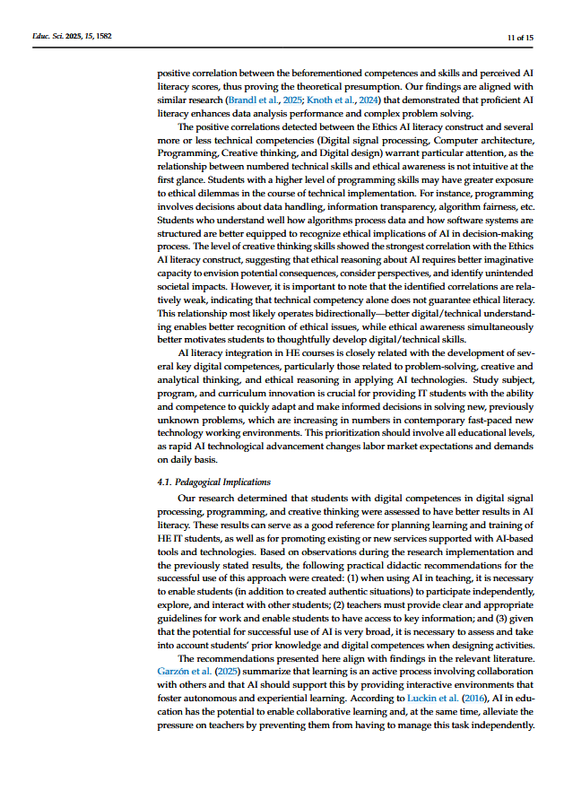
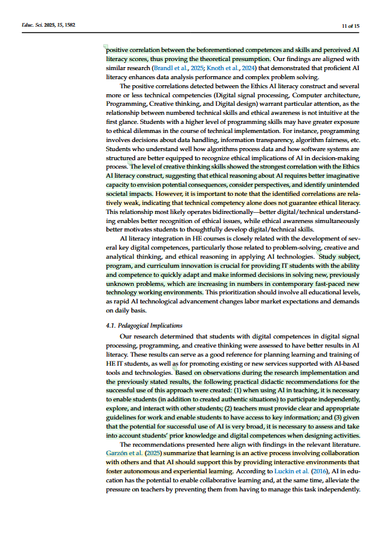
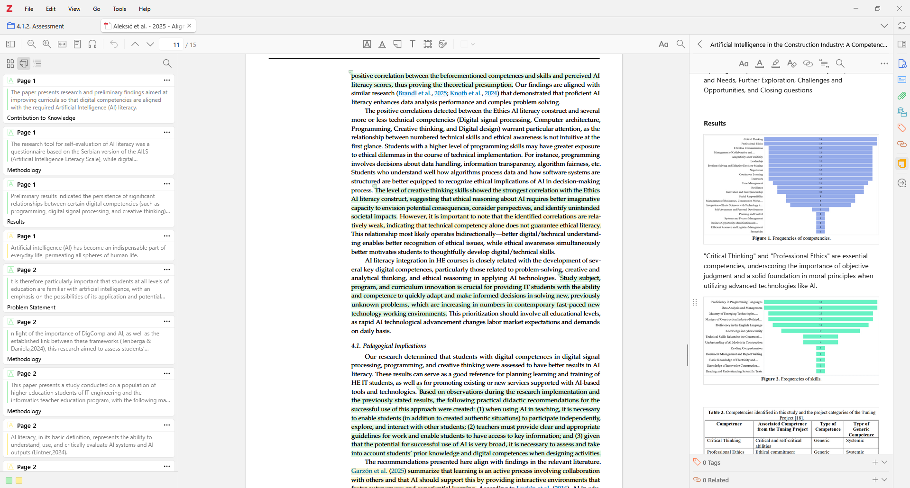

<h1 align="center">Highlight Research PDF</h1>


<a name="readme-languages"></a>

<details name="readme-language">
<summary><kbd>한국어</kbd></summary>

[<kbd>English</kbd>](#user-content-english-readme)

> **교수님은 논문 리뷰를, GTA 6는 내 저녁을.**<br>
> AI 채팅을 닫아도, 하이라이트는 논문에 남습니다.

## 어떤 기능인가요?

Codex에 논문 PDF를 주면, 본문에서 읽을 만한 문장을 골라 하이라이트가 들어간 PDF 사본을 만듭니다. 원본 PDF는 그대로 보존합니다.

| 색상 | 표시하는 문장 |
| :--- | :--- |
| **🟨&nbsp;노란색** | 문단의 요지를 가장 잘 담은 문장입니다. 주석 코멘트는 비워 둡니다. |
| **🟩&nbsp;초록색** | 연구 문제(Problem Statement), 연구 공백(Research Gap), 연구 질문(Research Question), 연구 방법(Methodology), 연구 결과(Results), 학문적 기여(Contribution to Knowledge), 실무적 의의(Practical Significance)를 직접 설명하는 문장입니다. 해당 역할을 주석 코멘트에 남깁니다. |

문단의 핵심 문장이 연구 역할에도 해당하면 초록색으로 한 번만 표시합니다.

### 하이라이트 전후 비교

같은 논문의 같은 페이지입니다. 이미지를 누르면 원본 크기로 볼 수 있습니다.

| 적용 전 · 원본 PDF | 적용 후 · 하이라이트 PDF |
| :---: | :---: |
| [](docs/images/before.png) | [](docs/images/after.png) |

## 추천 사용법 · Zotero에서 메모하며 읽기

1. **하이라이트하기.** Codex에 논문을 첨부하고 하이라이트가 포함된 PDF 사본을 요청합니다.
2. **주석 가져오기.** Zotero의 논문 항목에 사본을 첨부하고 PDF 리더에서 엽니다. **File → Import Annotations…**를 선택하면 가져온 하이라이트를 Zotero에서 편집할 수 있습니다. [Zotero 주석 가져오기 문서](https://www.zotero.org/support/kb/annotations_in_database#interacting_with_embedded_annotations)
3. **오른쪽에 메모하며 읽기.** 왼쪽 주석 목록으로 문장을 찾아가고, 오른쪽 **Notes** 패널에 메모를 엽니다. 하이라이트를 메모로 끌어오면 해당 문장으로 돌아갈 수 있습니다. 저자의 근거가 주장을 얼마나 잘 뒷받침하는지, 내 문헌고찰에서 어디에 인용할지 옆에 적어 보세요. [Zotero PDF 리더와 노트 편집기](https://www.zotero.org/support/pdf_reader)

[](docs/images/zotero-reading.png)

*왼쪽에서 주석을 고르고, 가운데에서 원문을 읽고, 오른쪽에서 메모합니다.*

## Codex에 설치하기

Git과 Python이 설치되어 있다면 PowerShell, Git Bash 또는 macOS/Linux 셸에서 아래 명령을 실행하세요. PyMuPDF는 하이라이트 스크립트에 사용할 Python 환경에 설치합니다.

```sh
git clone https://github.com/giocosogiocondo/highlight-research-pdf.git "$HOME/.agents/skills/highlight-research-pdf"
python -m pip install -r "$HOME/.agents/skills/highlight-research-pdf/requirements.txt"
```

Codex에 PDF를 첨부하고 다음처럼 요청하세요.

> `$highlight-research-pdf`로 이 논문에 하이라이트를 표시하고, 주석이 들어간 PDF 사본을 만들어 줘.

특정 프로젝트에서만 쓰려면 [Codex 스킬 설치 위치 문서](https://learn.chatgpt.com/docs/build-skills#where-codex-loads-local-skills)를 참고하세요.

## 고른 문장에 직접 표시하기

[주석 스크립트](scripts/annotate.py)는 가로로 쓰인 텍스트를 선택할 수 있는 PDF에서 동작합니다. UTF-8 `selections.json`에 실제 PDF의 1부터 시작하는 페이지 번호와 원문 문장을 적습니다. 노란색이면 `roles`를 생략하고, 초록색이면 위 표의 영어 역할 이름을 그대로 사용하세요.

```json
[
  {"page": 1, "text": "The exact sentence selected from the PDF."},
  {"page": 2, "text": "The exact sentence that states the research gap.", "roles": ["Research Gap"]}
]
```

스킬 폴더에서 실행합니다.

```sh
python scripts/annotate.py input.pdf selections.json highlighted.pdf
```

출력에는 새 파일 이름을 쓰세요. 스캔본이나 회전된 텍스트의 처리 방법은 [SKILL.md](SKILL.md)를 참고하세요.

## 스크린샷 출처

PDF 예시는 Aleksić, Mandić, Ivanović(2025)의 논문 11쪽입니다. 적용 후 이미지와 Zotero 화면에는 하이라이트를 추가했습니다. [논문](https://doi.org/10.3390/educsci15121582) · [CC BY 4.0](https://creativecommons.org/licenses/by/4.0/)

Zotero 스크린샷 오른쪽 메모의 그림은 Hector Buyones-Gonzalez와 Monica Quezada-Espinoza(칠레 Universidad Andrés Bello)가 미국 오리건주 포틀랜드에서 열린 2024 ASEE Annual Conference & Exposition에서 발표한 논문에서 가져왔습니다. © 2024 American Society for Engineering Education. [ASEE 논문](https://peer.asee.org/artificial-intelligence-in-the-construction-industry-a-competency-based-examination-through-expert-lens)

</details>

<details name="readme-language" open>
<summary><kbd>English</kbd></summary>

<a name="english-readme"></a>

> **My professor wants a literature review. GTA 6 wants my evening.**<br>
> Close the AI chat. The highlights stay in the paper.

## What it does

Give Codex a research paper. The skill picks full sentences from the original text and saves a PDF copy with embedded highlights. Your source PDF stays intact.

| Color | What it marks |
| :--- | :--- |
| **🟨&nbsp;Yellow** | The sentence that best captures the point of a substantive paragraph. The highlight has no comment. |
| **🟩&nbsp;Green** | Sentences that state a **Problem Statement**, **Research Gap**, **Research Question**, **Methodology**, **Results**, **Contribution to Knowledge**, or **Practical Significance**. The highlight comment carries the matching label or labels. |

If a paragraph's key sentence also serves a research role, it gets a single green highlight.

### Before and after

The same page before and after highlighting. Select either image to see it at full size.

| Before · Original PDF | After · Annotated PDF |
| :---: | :---: |
| [](docs/images/before.png) | [](docs/images/after.png) |

## Read and take notes in Zotero

1. **Highlight.** Ask Codex to highlight the paper and save an annotated PDF copy.
2. **Import.** Attach the copy to the paper's Zotero entry and open it in the Zotero PDF reader. Choose **File → Import Annotations…** to make the highlights editable in Zotero. [Zotero documentation](https://www.zotero.org/support/kb/annotations_in_database#interacting_with_embedded_annotations)
3. **Read with Notes open.** Use the left Annotations pane to jump to a passage and the right Notes pane to write as you read. Drag a highlight into your note to keep a link to the passage. Then write your own take, such as how the authors' evidence supports the claim or where you would use it in your review. [Zotero PDF Reader and Note Editor](https://www.zotero.org/support/pdf_reader)

[](docs/images/zotero-reading.png)

*A reading setup with annotations on the left, the paper in the middle, and notes on the right.*

## Install in Codex

With Git and Python installed, run these commands in PowerShell, Git Bash, or a macOS/Linux shell. Install PyMuPDF in the Python environment that will run the annotation script.

```sh
git clone https://github.com/giocosogiocondo/highlight-research-pdf.git "$HOME/.agents/skills/highlight-research-pdf"
python -m pip install -r "$HOME/.agents/skills/highlight-research-pdf/requirements.txt"
```

Attach the PDF in Codex and try this prompt.

> Use `$highlight-research-pdf` to highlight this paper and save an annotated PDF copy.

See the [Codex skill documentation](https://learn.chatgpt.com/docs/build-skills#where-codex-loads-local-skills) for project-scoped installation.

## Apply your own selections

The [annotation script](scripts/annotate.py) takes reviewed excerpts from a PDF with horizontal, selectable text. Use one-based PDF page numbers and exact excerpts in a UTF-8 `selections.json` file. Omit `roles` for yellow, or use the exact English role names above for green.

```json
[
  {"page": 1, "text": "The exact sentence selected from the PDF."},
  {"page": 2, "text": "The exact sentence that states the research gap.", "roles": ["Research Gap"]}
]
```

Run this command from the skill folder.

```sh
python scripts/annotate.py input.pdf selections.json highlighted.pdf
```

Choose a new output filename. For scans and rotated text, see the OCR and layout guidance in [SKILL.md](SKILL.md).

## Screenshot credits

The PDF example uses page 11 of Aleksić, Mandić, and Ivanović (2025), with highlights added in the after and Zotero views. [Paper](https://doi.org/10.3390/educsci15121582) · [CC BY 4.0](https://creativecommons.org/licenses/by/4.0/)

The right-hand note in the Zotero screenshot shows figures from Hector Buyones-Gonzalez and Monica Quezada-Espinoza (Universidad Andrés Bello, Chile), presented at the 2024 ASEE Annual Conference & Exposition in Portland, Oregon. © 2024 American Society for Engineering Education. [ASEE paper](https://peer.asee.org/artificial-intelligence-in-the-construction-industry-a-competency-based-examination-through-expert-lens)

</details>
